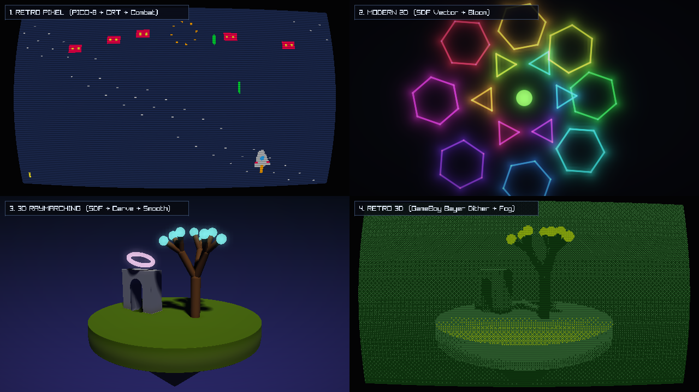

# TurtleFX — Modern Logo Shader Engine

> **Made with Gemini Neon** ✨  
> 📖 **[Interactive Tutorial & Browser Playground](https://xyzzyapps.github.io/turtlefx/)** · 📘 **[Complete Single-Page Language Reference](https://xyzzyapps.github.io/turtlefx/language.html)**

A lightweight **C11 + raylib 5.5** game renderer scripted in a **modern Logo dialect** whose entire OpenGL 3.3 GPU shader pipeline — **Retro Pixel**, **2D Vector SDF**, **3D SDF Raymarching**, and **Cross-Mode Post-FX** — is completely abstracted away from the user.



---

## Highlights

- **4 Rendering Styles, Zero GLSL Written by the User**
  1. **Retro Pixel (`mode retro(320, 180)`)** — Integer-snapped pixel turtle, ear-clipped concave polygon fills, indexed palettes (`pico8`, `gameboy`, `cga`, `sunset`), and CRT barrel/scanline shaders.
  2. **Modern 2D (`mode 2d`)** — Resolution-independent 2D Signed Distance Field strokes & shapes, exponential neon glow halos, additive blending, and 2-pass separable Gaussian bloom.
  3. **3D Raymarching + Native Raylib Meshes & 2.5D Sprites (`mode 3d`)** — Full 3D orthonormal turtle frame (`pitch`, `yaw`, `roll`), 3D SDF primitives (`sphere`, `capsule`, `box`, `cylinder`, `cone`, `torus`), procedural `stone` & `tiles` materials, polynomial smooth blending (`smooth`), boolean subtraction (`carve`), soft shadows, dynamic emissive bounce lights — depth-composited cleanly with native raylib **`.obj` / `.glb` 3D models** (`model(...)`) and **2.5D pixel-art billboard sprites** (`sprite(...)`, supporting `.png` sheets or inline `"""..."""` ASCII art).
  4. **Cross-Mode Post-FX** — Route any 2D or 3D Logo scene through `fx retro(...)`, 4×4 Bayer ordered dithering, distance fog, bloom, CRT curvature, and vignette in two lines of Logo.
- **Live Hot-Reloading** — Edit and save any `.logo` script while the engine is running to update the scene instantaneously with on-screen syntax/runtime error overlays.

---

## Build & Run

Requires **CMake 3.20+**, a C11 compiler (`gcc` / `clang` / MSVC), and **raylib 5.x**.

```powershell
cmake -B build -G Ninja
cmake --build build
.\build\turtlefx.exe
```

Run a specific `.logo` script, launch the **slow-motion visual turtle debugger** (`-debug`), or run the headless test suite:

```powershell
.\build\turtlefx.exe examples\03_3d_crystal_tree.logo
.\build\turtlefx.exe -debug examples\02_neon_2d.logo
.\build\turtlefx.exe -debug --speed 0.1 examples\07_hades_courtyard.logo
.\build\turtlefx.exe --verify
```

---

## Controls

| Key | Action |
|---|---|
| `1` – `7` | Switch live between built-in examples (`Retro Arcade`, `Neon 2D`, `3D Crystal Tree`, `Retro 3D`, `Custom GLSL Shader`, `Actor Swarm`, `Hades Isometric 3D`) |
| `WASD` / `Arrows` | Move (`01_retro_arcade`, `06_actor_swarm`, `07_hades_courtyard` isometric) |
| `Space` / `Shift` / `E` | Fire / 3-Hit Sword Slash (`Space`), Fiery Dash (`Shift`), Bloodstone Cast (`E`) |
| `F5` (or `-debug` flag) | Toggle **Slow-Motion Turtle Debugger** with live turtle reticle & analog/digital simulated clock |
| `Tab` · `,` / `.` · `N` · `-` / `+` · `Backspace` | In Debug Mode: Pause/Resume clock, step 1 turtle op back/forward, step +1 frame, adjust speed, replay frame from step 0 |
| `R` | Reload active `.logo` script manually (also auto hot-reloads on file save) |
| `H` | Toggle HUD overlay |
| `F12` / `P` | Save in-game screenshot (`screenshot_001.png`, ...) |

---

## Modern Logo Quick Reference

```logo
mode 3d
sky gradient(#0b1120, #312e81)
light sun(dir: [-1, -2, -1], color: #ffe8cc, shadows: soft)
fx bloom(strength: 0.55, radius: 10)

to tree(len, radius, depth)
  if depth == 0 [
    material emissive(#38bdf8, strength: 2.2)
    sphere(radius * 2.4)
    stop
  ]
  material matte(#6b4423)
  capsule(len, radius)
  fd len
  branch [ roll 15   pitch 28  tree(len * 0.72, radius * 0.72, depth - 1) ]
  branch [ roll 135  pitch 30  tree(len * 0.70, radius * 0.72, depth - 1) ]
  branch [ roll 255  pitch 26  tree(len * 0.68, radius * 0.72, depth - 1) ]
end
```

- **Modes & Shaders**: `mode retro(w, h) | 2d | 3d`, `palette pico8 | gameboy | cga | sunset`, `fx crt(...)`, `fx bloom(...)`, `fx retro(...)`, `fx fog(...)`, `fx vignette(...)`, `fx shader("my.fs", amount: ..., speed: ...)`
- **Actors & Messaging**: `actor name ... end`, `spawn [N] name [here] [with i] [...]`, `despawn`, `send target msg(...)`, `broadcast name msg(...)`, `find_nearest(name, radius: R)`, `count_actors(name)`, `look_at target`, `distance(target)`
- **Audio (WAV)**: `play("examples/sfx/laser.wav", volume: 0.6, pitch: 1.0)`
- **2D / Retro Turtle**: `fd`, `bk`, `rt`, `lt`, `pu`, `pd`, `dot`, `circle`, `rect`, `fill [ ... ]`, `color`, `pen_width`, `glow`, `blend add | alpha`
- **3D Turtle, SDFs, Sprites & Models**: `pitch`, `yaw`, `roll`, `sphere`, `capsule`, `box`, `cylinder`, `cone`, `torus`, `material matte | glossy | emissive | stone | tiles(...)`, `smooth k [ ... ]`, `carve [ ... ]`, `sprite(path_or_ascii, cols:, rows:, frame:, flip_x:, size:, tint:)`, `model("prop.obj" | "prop.glb", scale:, wireframe:, tint:)`, `light sun(...)`, `camera(...)`
- **Scoped Transforms**: `branch [ ... ]`, `at x y [ ... ]`, `at x y z [ ... ]`, `offset x y [ ... ]`
- **State & Control Flow**: `let x = 0`, `let arr = [1, 1, 1]`, `arr[i]`, `"""multiline string"""`, `if ... [ ... ] else [ ... ]`, `repeat N with i [ ... ]`, `while ... [ ... ]`, `to name(...) ... end`, `on frame(dt) ... end`

---

## Architecture

```text
 .logo Script ──► Lexer/Parser (AST) ──► Logo VM & 2D/3D Turtle ──► SceneIR ──► RGBA32F Data Textures ──► 5 GLSL 330 Shaders
```

- **`src/logo_parser.c`** — Lexer and recursive-descent AST parser supporting chained bare commands, `[ ... ]` scoped blocks, list indexing, and named shader parameters.
- **`src/logo_vm.c`** — Executes scripts each frame, maintains 2D/3D orthonormal turtle state, ear-clips concave `fill` polygons, and emits flat `Prim2D` / `Prim3D` buffers.
- **`src/renderer.c` & `src/shaders.h`** — Uploads primitives via `RGBA32F` floating-point textures (`texelFetch`) into hidden OpenGL 3.3 SDF, raymarching, bloom, and post-FX shaders.

---

## Credits & Attribution

- **Author**: **Xyzzy Apps** ([@xyzzyapps](https://github.com/xyzzyapps) · `xyzzyapps@gmail.com`)
- **Built with**: Made with **Gemini Neon**

## License

Licensed under the **[PolyForm Noncommercial License 1.0.0](LICENSE)**.  
Copyright © 2026 Xyzzy Apps. Noncommercial use only — see [LICENSE](LICENSE) for full terms.
